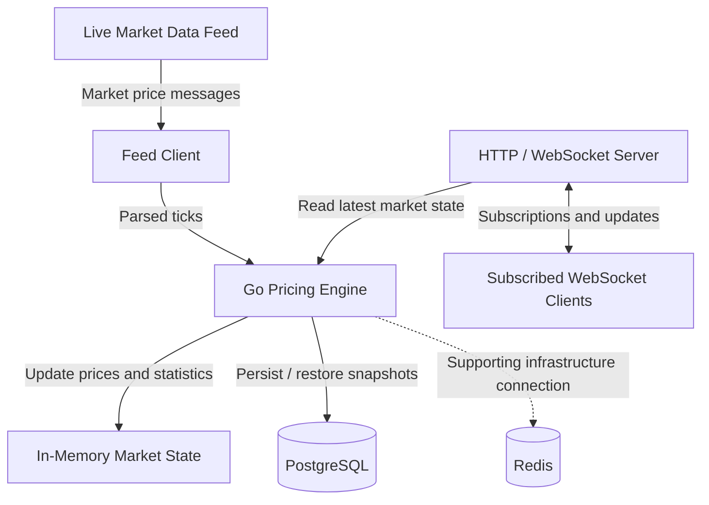

# Real-Time Pricing Engine

A Go-based real-time market pricing service that consumes live market data, processes price updates, calculates rolling 24-hour statistics, persists historical snapshots in PostgreSQL, and streams updates to subscribed WebSocket clients.

## Features

- Live market data ingestion through a provider WebSocket feed.
- Price tick decoding, validation, and normalization.
- Rolling 24-hour market statistics.
- Duplicate and out-of-order tick handling.
- In-memory market state for fast access to current prices.
- PostgreSQL persistence and historical snapshot restoration.
- Redis infrastructure integration.
- HTTP health endpoint.
- WebSocket connections and symbol subscriptions.
- Docker Compose support for local infrastructure and application startup.

## Tech Stack

| Component | Technology |
|---|---|
| Backend | Go |
| HTTP server | Gin |
| Market data ingestion | WebSocket |
| Client price streaming | WebSocket |
| Historical storage | PostgreSQL |
| Supporting infrastructure | Redis |
| Container orchestration | Docker Compose |
| Testing | Go testing package |

## Architecture

The application separates market data ingestion, price processing, state management, persistence, and client-facing WebSocket delivery.



Redis is shown as supporting infrastructure. Its precise role depends on the current Redis implementation.

See [Architecture and Data Flow](docs/ARCHITECTURE.md) for component details.

## Prerequisites

- Go version compatible with `go.mod`, if running locally.
- Docker Desktop with the Docker engine running.
- Docker Compose.
- Valid market feed credentials.
- PostgreSQL and Redis configuration required by the application.

## Configuration

Create a local `.env` file in the location expected by your application.

Configure the environment variables required for:

- Market feed credentials.
- PostgreSQL connection.
- Redis connection.
- JWT authentication.
- HTTP server configuration, if configurable.

For example:

```env
JWT_SECRET=replace_with_a_random_secret_of_at_least_32_characters
```

Use a cryptographically random secret. This example is a placeholder, not a production credential.

Keep `.env` out of version control. Rotate any credentials that have previously been exposed.

## Run with Docker Compose

From the directory containing your Compose file:

```bash
docker compose config
docker compose up --build
```

To run in the background:

```bash
docker compose up --build -d
```

Check container status:

```bash
docker compose ps
```

View logs:

```bash
docker compose logs -f
```

If your Compose configuration defines only Redis and PostgreSQL, start those services with:

```bash
docker compose up -d redis postgres
```

In that case, run the Go application separately.

## Run Locally

Run commands from the working directory expected by your current application configuration.

For a project with `server/main.go` inside `cmd`:

```powershell
go run server/main.go
```

If your entry point is instead `cmd/server/main.go`, run from the module root:

```powershell
go run ./cmd/server
```

Ensure environment configuration is loaded before initializing services that depend on it.

## Health Check

Once the HTTP server is running, request:

```http
GET http://localhost:8080/health
```

Example response:

```json
{
  "status": "ok"
}
```

Replace port `8080` if your application uses a different port.

This endpoint confirms that the HTTP server responds; it does not necessarily verify the health of PostgreSQL, Redis, or the market feed.

## WebSocket

Connect using a WebSocket client:

```text
ws://localhost:8080/ws
```

Use the subscription message supported by the application's WebSocket implementation to subscribe to market symbols.

The upstream provider connection and client-facing WebSocket endpoint are separate connections. Successful client connection does not, by itself, guarantee that live market data is flowing.

## Run Tests

From the Go module root:

```bash
go test ./...
```

Run static analysis:

```bash
go vet ./...
```

Build the project:

```bash
go build ./...
```

## Performance Notes

The current serialized `PriceSnapshot` test payload measured **154 bytes**, below the 10 KB payload-size target.

End-to-end processing and WebSocket delivery latency have not yet been benchmarked under realistic load. The 50 ms latency target should not be considered satisfied until benchmark results demonstrate it.

## Challenges and Engineering Decisions

See [Challenges Faced and Solutions](docs/CHALLENGES.md) for details about Docker startup, provider payload compatibility, WebSocket concurrency, duplicate ticks, test discovery, and performance trade-offs.

## Documentation

- [Architecture and Data Flow](docs/ARCHITECTURE.md)
- [Challenges Faced and Solutions](docs/CHALLENGES.md)

## Security

- Never commit `.env`, JWT secrets, or market feed credentials.
- Use secure connections in production.
- Validate incoming market data and API inputs.
- Restrict access to sensitive endpoints.
- Configure trusted proxies carefully if rate limiting depends on client IP.
- Rotate any credentials that may have been exposed.
