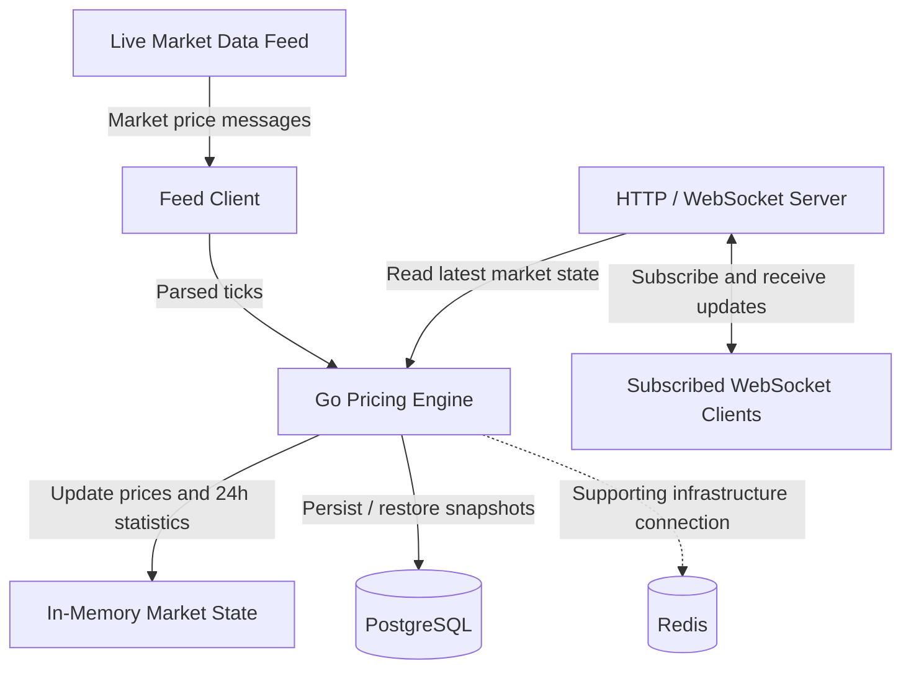

# Architecture and Data Flow

## Overview

The Real-Time Pricing Engine consumes live market prices, processes updates in Go, maintains market statistics, persists historical snapshots, and streams price updates to subscribed WebSocket clients.

## Architecture Diagram

> Update the Redis connection and data-flow labels if your implementation uses Redis for a specific purpose, such as caching or coordination. Do not claim functionality that is not implemented.

## Main Components

- **Market data feed:** Supplies live bid, ask, and market-related fields.
- **Feed client:** Connects to the provider and passes incoming messages to the application.
- **Pricing engine:** Processes price ticks, handles duplicate and out-of-order events, and calculates rolling 24-hour statistics.
- **In-memory state:** Keeps the latest price and price history used for calculations.
- **PostgreSQL:** Stores historical price snapshots and supports state restoration.
- **Redis:** Provides the configured Redis infrastructure connection.
- **HTTP/WebSocket server:** Exposes the health endpoint and allows clients to subscribe to live price updates.

## Data Flow

1. The feed client receives market data.
2. Incoming messages are decoded and validated.
3. The pricing engine updates the relevant symbol's state and statistics.
4. Price snapshots are persisted according to the application's storage implementation.
5. WebSocket clients connect and subscribe to symbols.
6. Clients receive updates for the symbols they subscribe to.
7. On startup, the application restores available historical snapshots from PostgreSQL.

## Design Considerations

- Separate feed ingestion, pricing logic, storage, and WebSocket delivery.
- Use synchronization when accessing shared in-memory state.
- Keep WebSocket writes controlled by a single writer per connection.
- Validate incoming prices and handle duplicate and out-of-order ticks.
- Keep WebSocket payloads compact.
