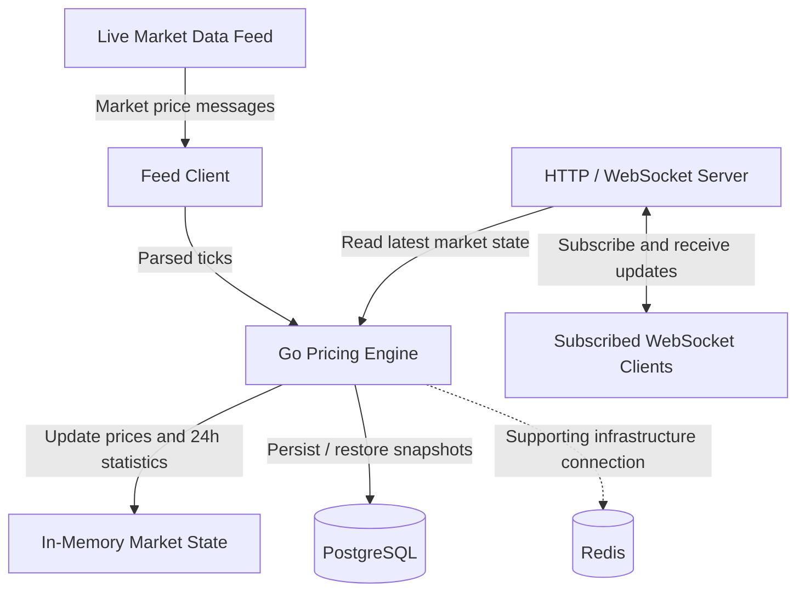

# Architecture and Data Flow

## Overview

The Real-Time Pricing Engine consumes live market prices, processes updates in Go, maintains market statistics, persists historical snapshots, and streams price updates to subscribed WebSocket clients.

The design separates feed ingestion, pricing calculations, state management, database persistence, and WebSocket delivery.

## Architecture Diagram



**Redis note:** The diagram shows Redis as supporting infrastructure. Update the connection labels when its exact role in the current implementation is confirmed. Do not imply that pricing state is cached or coordinated through Redis unless the code implements that behavior.

## Main Components

### 1. Market Data Feed

Supplies live bid, ask, and market-related fields through the configured provider connection.

The feed may send provider-specific field names, timestamp formats, or message structures. The application must normalize these into its internal market tick model.

### 2. Feed Client

Responsible for connecting to the provider, handling provider authentication, receiving messages, and passing decoded ticks to the pricing engine.

The client must handle connection failures and provider-specific session restrictions according to the provider's protocol.

### 3. Pricing Engine

Processes market ticks and updates the state associated with each symbol.

Responsibilities include:

- Validating market price data.
- Handling duplicate events.
- Preventing older ticks from incorrectly replacing newer quotes.
- Updating the latest price.
- Calculating rolling 24-hour statistics.
- Maintaining the data needed for price-history calculations.

### 4. In-Memory Market State

Stores current market information and the history needed by the pricing engine.

In-memory state allows fast access to recent prices but is lost when the process stops unless it is restored from persistence or another durable source.

Concurrent reads and writes must be synchronized correctly.

### 5. PostgreSQL

Stores historical price snapshots and supports restoration during application startup.

The known schema includes `price_history` and `merchants`. The exact table definitions, indexes, constraints, and retention policy are determined by the database schema implementation.

The application restores historical price snapshots from PostgreSQL during startup. The current implementation has previously restored a large historical dataset, so memory consumption and startup duration should be monitored.

### 6. Redis

Redis is configured as supporting infrastructure.

Document its exact responsibilities based on the current code. If it is used only for a connection or future integration, do not describe it as an active cache, persistence layer, or coordination system.

### 7. HTTP / WebSocket Server

The Gin server exposes HTTP routes and the client-facing WebSocket endpoint.

The HTTP health endpoint provides a basic availability check. The WebSocket hub handles client connections and subscriptions according to the implemented protocol.

## Data Flow

1. The feed client connects to the market data provider.
2. The provider sends market price messages.
3. The feed client decodes and validates the incoming payload.
4. Valid messages are normalized into market ticks.
5. The pricing engine applies duplicate and timestamp-aware processing.
6. The engine updates in-memory market state and calculates applicable statistics.
7. Price snapshots are persisted according to the storage implementation.
8. WebSocket clients connect and subscribe to supported symbols.
9. Clients receive price updates for their subscriptions.
10. At startup, the application restores available historical snapshots from PostgreSQL.

## Rolling 24-Hour Statistics

The pricing engine calculates rolling statistics using the available price history.

The midpoint is commonly calculated as:

```text
midpoint = (bid + ask) / 2
```

Percentage change can be calculated as:

```text
change_percent =
    ((current_midpoint - reference_midpoint)
    / reference_midpoint) * 100
```

The reference midpoint must correspond to the intended comparison time. A zero or unavailable reference value must be handled to avoid invalid calculations.

The calculation should account for the rolling time window and the timestamps of accepted ticks. Provider-reported percentages should not automatically be treated as equivalent to an internally calculated rolling percentage.

## Duplicate and Out-of-Order Ticks

Repeated messages can inflate history or cause unnecessary broadcasts. Delayed messages can also cause a stale price to replace a newer quote.

The engine applies duplicate detection and timestamp-aware processing to reduce these risks.

The exact deduplication key, event-time policy, and handling of late-arriving ticks should remain consistent with the implementation and be covered by tests.

## WebSocket Concurrency

WebSocket connections require careful read/write coordination.

The connection lifecycle should:

- Separate incoming-message handling from outgoing-message delivery.
- Control concurrent writes, ideally with a single writer per connection.
- Handle disconnects and cleanup.
- Maintain subscriptions safely.
- Avoid sending updates to clients after their connections have closed.

Payloads should remain compact to reduce bandwidth and serialization overhead.

## Persistence and Recovery

PostgreSQL provides durable historical snapshots. The in-memory state supports fast calculations and reads during normal operation.

Startup restoration allows the engine to reconstruct the available historical state after a restart. The restored dataset may not include every record if the restoration query applies limits or filters.

Recovery behavior should be tested with a populated database and after an unexpected application shutdown.

## Performance and Trade-offs

- In-memory state supports fast reads but consumes RAM.
- PostgreSQL provides durable storage but introduces database I/O overhead.
- Compact JSON snapshots reduce WebSocket bandwidth.
- Duplicate detection improves correctness but consumes processing time and may require additional memory.
- Historical restoration supports recovery but may increase startup time.
- Rolling-window expiration requires careful memory management.

The serialized `PriceSnapshot` test payload measured 154 bytes, below the 10 KB payload target.

End-to-end latency under realistic load remains to be benchmarked. A 50 ms target should only be claimed after measuring processing and delivery latency.

## Further Improvements

- Benchmark processing and end-to-end WebSocket delivery under realistic load.
- Test restart recovery and historical restoration.
- Test feed reconnection and provider session limits.
- Test malformed messages and high-volume update bursts.
- Verify rolling 24-hour expiration and memory usage under sustained traffic.
- Measure PostgreSQL query performance and indexing effectiveness.
- Validate subscription cleanup and WebSocket behavior under client churn.
- Add observability for feed health, processing errors, connection counts, and delivery latency.
